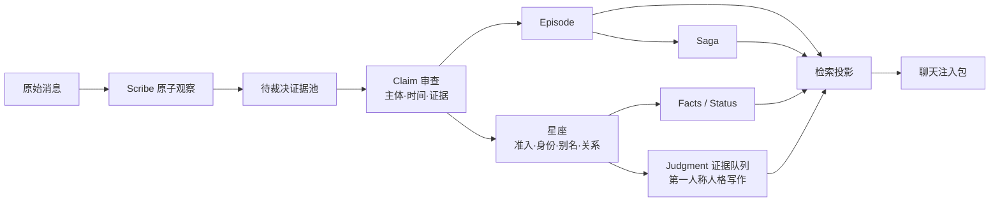

# Memory Constellations · 记忆星图

Memory Constellations 是面向长期 AI 伴侣的可审计记忆管线。它把聊天中的原始消息逐层转成有来源、可复核、可回滚的记忆，而不是把每个对话碎片直接宣布为事实。

它不是通用文档 RAG、无需治理的“全自动真相机器”，也不是聊天主模型。模型可以提出结构化判断；只有宿主程序能在校验证据、版本、租约与 CAS 条件后写入正式表。

## 数据如何流动



暂时无法归属的 Claim 会留在证据池。只有输入、证据或相关上下文的指纹发生变化才重新开放裁决；原样重试会转为 deferred，避免循环消耗。

## 每一层只做一件事

| 层 | 唯一职责 |
|---|---|
| Scribe observation | 由可替换的提取模型忠实拆出带精确引文的原子观察；不提前创建星座，不判断人格 |
| Claim / evidence pool | 保存来源、主体归属、时间状态、支持度和阻断原因 |
| Constellation | 管理可持续识别的实体、身份、别名、准入和关系 |
| Episode | 将已准入 Claim 组织成一次有边界的叙事 |
| Saga | 把已发布 Episode 组织成长程叙事弧线 |
| Facts | 可核对的客观字段 |
| Status | 有时效的近期状态 |
| Judgment | 伴侣人格的第一人称看法；独立证据门与版本边界 |
| Search projection | 只投影已经发布、允许聊天消费的内容 |

Facts、Status、Judgment 是三个独立发布流：各自有版本、来源、历史和回滚边界。Facts 或 Status 的成功不能替代 Judgment；Judgment 生成失败、证据不足或解析失败都不得覆盖旧值。

## 模型职责

| 角色 | 允许做什么 | 不允许做什么 |
|---|---|---|
| 确定性代码 | 指纹、精确引文、状态机、租约、CAS、写库、检索准入 | 猜测语义 |
| 结构化轻量模型 / 维护 Agent | Claim 分类、证据组装、主体与时间判断、Facts、Status、候选身份与别名；也可协助管线工程 | 任意 SQL；第一人称 Judgment |
| 第一人称人格模型 | 在证据充分且 persona 已绑定时生成非空 Judgment | 修改 Facts / Status；证据不足时硬写 |
| 聊天主模型 | 消费有边界的记忆包并回复用户 | 直接绕过发布协议改正式记忆 |

## 快速开始

要求 Node.js 18+、npm 和 SQLite 构建依赖。Python/ChromaDB 只在启用旧版向量检索时需要。

```bash
git clone https://github.com/ClaraShafiq/MemoryConstellations.git
cd MemoryConstellations
cp .env.example .env
cp memory_config.example.json memory_config.json
cp core-prompt.example.txt core-prompt.txt
npm install
npm run setup:llm
npm run test:memory-modern
npm start
```

先用 `openssl rand -hex 32` 生成密钥并填写 `.env`，其中 `MEMORY_LLM_PROVIDER`、`MEMORY_LLM_ENDPOINT`、`MEMORY_LLM_MODEL` 和 `MEMORY_LLM_API_KEY` 必须来自你实际使用的渠道；再运行上面的模型配置命令。打开 `http://localhost:3000/memory.html`；健康检查为 `GET /api/health`。首次启动会从空库迁移到 schema v112，不需要任何生产数据。详细步骤见 [OSS_SETUP.md](OSS_SETUP.md)。

## 两种部署路径

手动部署：按 [部署指南](OSS_SETUP.md) 完成依赖、密钥、公共角色配置、空库迁移、聚焦测试和健康检查。默认保持 legacy 读取及 backfill 暂停。

Agent 辅助部署：任何能读取仓库、修改文件并运行命令的 agentic IDE 都可以协助部署。Codex 的安装与登录以 [Codex CLI](https://learn.chatgpt.com/docs/codex/cli) 和 [Codex IDE](https://learn.chatgpt.com/docs/codex/ide) 官方文档为准。

部署助手与运行期维护者不同：

- 部署助手只需要操作仓库和命令。
- 运行期维护者必须实现本项目的类型化 JSON action、证据校验、租约和 CAS 协议。
- 当前仓库实现了 Codex CLI 的只读提案适配器与受控宿主；其他 Agent 可按接口接入，但不是开箱即用的原生支持。
- 具体产品的安装、登录、支持环境和额度可能变化；请以供应商官方资料为准。

## 验证

```bash
DB_PATH=/tmp/memory-constellations-test.sqlite \
SANCTUARY_ENCRYPTION_KEY=$(openssl rand -hex 32) \
npm run test:memory-modern
npm run test:memory-lanes
npm run test:llm-config
npm run check:docs
npm run check:privacy
curl http://localhost:3000/api/health
```

健康响应中的 `claims`、`evidence`、`episodes`、`profile_fields` 与 `search_units` 对应 Claim、证据池、Episode、三字段 Profile 和检索投影。测试细节见 [测试文档](docs/TESTING.md)。

## 隐私、安全、备份和费用

- 不提交 `.env`、数据库、聊天记录、人格私有 prompt、日志、Cookie 或登录目录。
- 原始消息、Claim 证据和现代发布记录使用 AES-256-GCM 加密；旧 UI 的兼容投影仍沿用既有表约定。请离线备份密钥与 SQLite 数据库。
- Agent 没有任意 SQL 写权限；`memoryCodexExecutor.js` 只接受 allowlist action。
- 示例 fixture 是虚构、中性数据。
- 模型费用由所选供应商、模型、缓存规则和实际 token 量决定；本项目不提供会迅速过期的固定报价。请按 [费用核算方法](docs/COST.md) 记录自己的实测用量，并以供应商当日官方资料结算。
- 启用现代读侧前先备份并完成真实消息端到端验收。

## Current status / Roadmap

阶段 1–5 的基础设施和受控写入架构已实现：原子观察、Claim 证据池、准入阻断原因、实时/回补车道、类型化审查动作、星座身份/别名、Episode、Saga、字段级 Profile 发布和检索投影均有公共实现与聚焦测试。

但“实现”不等于“已完成生产切换”：

- 参考部署的正式写入/审核链（maintenance）已经是 `running`，且在线 runner 只消费实时车道；历史回补不会被自然在线调度。
- 参考部署的聊天读取（verified read mode）仍保持 `memory_chat_read_mode=legacy`。写入链 running 不等于聊天消费者已经切换。
- 新 Profile 字段表已迁移，但还没有来自全新自然聊天链路的完整生产发布样本。
- 单案验收中，证据不足时 Judgment 留空表现正确，但 Status 动作判断未通过。
- 阶段 6（宏观认知/直觉模块）与阶段 7（最终检索路由和完整消费者切换）尚未完成。
- 尚未完成“新真实消息 → 全链路写入 → 人格模型实际召回”的最终验收。

开源默认配置仍使用 legacy / backfill，避免安装即触发模型调用。参考部署的 running / legacy 状态与这个安全安装默认值并不矛盾。测试通过只证明协议回归，不代表真实生产链路已经验收。

## 文档

- [部署指南](OSS_SETUP.md)
- [记忆架构](docs/MEMORY_ARCHITECTURE.md)
- [配置说明](docs/CONFIGURATION.md)
- [数据库迁移约定](docs/MIGRATIONS.md)
- [能力同步状态](docs/PORTING_STATUS.md)
- [测试与验收](docs/TESTING.md)
- [故障排查](docs/TROUBLESHOOTING.md)
- [费用边界](docs/COST.md)

License: MIT（见 [LICENSE](LICENSE)）。
