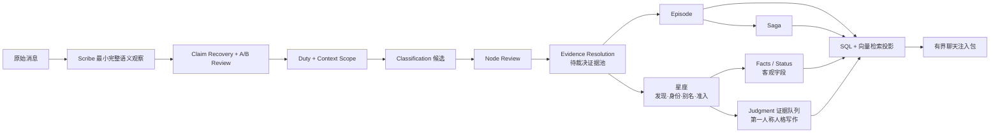

# Memory Constellations · 记忆星图

Memory Constellations 是一条面向长期 AI 关系的可审计记忆管线。它把原始消息逐层变成有精确来源、可复核、可回滚的记忆发布物；它不会把每段聊天直接宣布为事实。

它不是聊天主模型、通用文档 RAG，也不是“无需审查的全自动真相机器”。模型只能提出结构化判断，正式写入由宿主校验证据、闭集 schema、版本、租约与 CAS 条件后完成。

## 数据流



暂时无法归属的 Claim 不会丢弃。它保留在证据池中；相同证据指纹的重复裁决进入 `deferred`，只有来源、合同版本、审查结论或相关上下文变化才重开。A/B 审核互相独立，分歧不强行发布。被拒 Claim 进入精确消息恢复流程，不会退回派生 Fragment 正文重新猜测，也不会撤回同 Fragment 中已经通过的兄弟 Claim。

## 层级边界

| 层 | 唯一职责 |
|---|---|
| Fragment / Scribe observation | 从同一表达批次提取带逐字引文的最小完整语义单元，不提前创建星座或判断人格 |
| Claim / evidence pool | 保存主体、来源、时间、支持度、职责、归属和阻断原因 |
| Constellation | 维护有导航价值的实体身份、证据化别名和准入状态 |
| Episode | 把合格 Claim 组织成一次有边界、可版本化的事件叙事 |
| Saga | 只用已发布 Episode 组织长程叙事弧线 |
| Profile | 分别发布 Facts、Status、Judgment，不把三者混成一段文本 |
| Search projection | 把允许消费的发布物同步到 SQL 与带回执的向量投影 |
| Macro Insight | 规划中的跨事件认知层；当前没有正式聊天路由验收 |

Facts、Status、Judgment 各自拥有 revision、来源、历史和回滚边界。Facts 以当前可信基线为底，只对新增或纠正 Claim 做 `add/revise/withdraw`；Status 只接收近期动态。Judgment 以稳定态度 facet 保存，支持 `add/reinforce/revise/withdraw`，但必须来自 assistant 原始态度证据或经审核的 seed。证据不足、调用失败或解析失败不得覆盖旧值。

Duty 固定为 `stable_fact / core_trait / partner_pattern / current_state / event / preference / opinion / fiction / third_party / unresolved`；情境范围固定为 `general / with_draco / specific_event / reference_material / unknown`。公开配置中的 `with_draco` 是兼容协议值，语义是“与本部署 assistant/persona 的明确关系情境”，不是要求使用某个角色名。对象角色固定为 `subject / participant / location / organization / work / topic / mention`。

## 四类执行者

| 角色 | 可以做 | 不可以做 |
|---|---|---|
| 确定性代码 | 指纹、逐字校验、状态机、预算、租约、CAS、正式写库、发布门禁 | 猜测语义 |
| 结构化模型 / 维护 Agent | 客观分类、证据审核、Claim Recovery、星座维护、Facts、Status、管线工程 | 任意 SQL；第一人称 Judgment |
| 人格写作者 | 在 persona 已绑定且态度证据充分时生成非空 Judgment | 修改 Facts/Status；用事实数量硬造态度 |
| 聊天主模型 | 消费有界记忆包并回复 | 绕过发布协议直接改成品记忆 |

Scribe、维护 Agent、人格写作者和聊天主模型都可替换供应商，但实现必须保留同样的精确证据、闭集输出、版本/CAS、租约和唯一写入者合同。项目不要求特定模型、会员计划或 IDE。

## 快速开始

要求 Node.js 18+、npm、OpenSSL 和 `better-sqlite3` 构建工具链。verified 向量发布还需要可选的 Python/Chroma 服务。

```bash
git clone https://github.com/ClaraShafiq/MemoryConstellations.git
cd MemoryConstellations
cp .env.example .env
cp memory_config.example.json memory_config.json
cp core-prompt.example.txt core-prompt.txt
npm install
DB_PATH=./memory_constellations.db npm run setup:llm
DB_PATH=./memory_constellations.db npm start
```

先在 `.env` 填写两个不同的随机密钥、登录密码和你自己的模型 endpoint；再编辑公共角色配置。首次启动会从空库迁移到 schema v124，不需要任何外部生产数据。完整步骤见 [OSS_SETUP.md](OSS_SETUP.md)。

## 手动部署与 Agent 辅助部署

手动部署按 [部署指南](OSS_SETUP.md) 完成配置、空库迁移、测试、健康检查和分阶段切换。

任何能读取仓库、修改文件并运行命令的 agentic IDE 都可以帮助部署。Codex 的公开能力与使用入口以 [OpenAI 官方 Codex 文档](https://developers.openai.com/api/docs/guides/code-generation) 为准。部署助手与运行期维护者是两种角色：

- 部署助手只操作仓库和命令。
- 运行期维护者必须接收宿主生成的只读证据快照，并返回 `memoryCodexReviewPolicy.js` 允许的类型化 JSON action。
- 当前仓库提供 Codex CLI 的只读提案适配器和受控执行宿主；其他 Agent 可按同一接口接入，但不代表已经原生支持所有 IDE。
- 运行期 Agent 没有 SQL、shell 或第一人称 Judgment 写权限。

## 验证与启用

```bash
DB_PATH=/tmp/memory-modern.sqlite SANCTUARY_ENCRYPTION_KEY=$(openssl rand -hex 32) npm run test:memory-modern
DB_PATH=/tmp/memory-scribe-units.sqlite SANCTUARY_ENCRYPTION_KEY=$(openssl rand -hex 32) npm run test:memory-scribe-units
DB_PATH=/tmp/memory-lanes.sqlite SANCTUARY_ENCRYPTION_KEY=$(openssl rand -hex 32) npm run test:memory-lanes
DB_PATH=/tmp/memory-extensions.sqlite SANCTUARY_ENCRYPTION_KEY=$(openssl rand -hex 32) npm run test:memory-extensions
DB_PATH=/tmp/memory-derived-state.sqlite SANCTUARY_ENCRYPTION_KEY=$(openssl rand -hex 32) npm run test:memory-derived-state
DB_PATH=/tmp/memory-correction-feedback.sqlite SANCTUARY_ENCRYPTION_KEY=$(openssl rand -hex 32) npm run test:memory-correction-feedback
SANCTUARY_ENCRYPTION_KEY=$(openssl rand -hex 32) npm run test:memory-latest-contracts
SANCTUARY_ENCRYPTION_KEY=$(openssl rand -hex 32) npm run test:memory-background
SANCTUARY_ENCRYPTION_KEY=$(openssl rand -hex 32) npm run test:memory-v124-upgrade
npm run test:llm-config
npm run check:docs
npm run check:privacy
curl http://127.0.0.1:3000/api/health
```

`pipeline.mode=modern` 只选择现代调度器；`npm run memory:maintenance:start` 才让正式写入/审核链运行。聊天消费者切到现代发布物是另一件事：必须先完成向量回执并执行 `memory:release:prepare`，确认无 blocker 后再执行 `memory:release:activate`。激活后若投影变化或门禁失效，verified 读取会 fail-closed 并返回 503；它不会悄悄读取可能已经陈旧的 legacy 记忆。只有 `memory:release:rollback` 会显式恢复 legacy。

modern 调度由受监督子进程执行。外部聊天宿主应在生成回复前调用 `/api/memory/runtime/foreground/start`，结束后调用 `/api/memory/runtime/foreground/end`；租约存续及结束后一分钟冷却期间不会启动新的后台阶段。`/api/recall` 自身会自动登记短租约，并采用 SQL 优先、向量最多等待 300ms 的有界读取。

派生状态使用统一健康入口：

```bash
DB_PATH=./memory_constellations.db npm run memory:health:check
DB_PATH=./memory_constellations.db npm run memory:health:verify
DB_PATH=./memory_constellations.db npm run memory:health:repair
DB_PATH=./memory_constellations.db npm run memory:health:repair -- --execute
```

`check` 只检查本地新鲜度、积压、租约、SQL/向量 receipt；`verify` 还核对远端缺失、陈旧、待删除和多余向量。`repair` 默认只预演；`--execute` 才会从正式 Claim/Episode/Saga/Profile 发布物重建投影并修复远端。legacy 模式会同时检查旧 FTS，modern 模式不会让旧索引重新成为权威来源。

本地向量账目缺口无论聊天当前读取 legacy 还是 verified 都会报告；读模式只决定正式消费者与是否需要远端验收，不会隐藏本地 receipt 漂移。健康报告覆盖新鲜度、租约、receipt、manifest 和适用的旧 FTS，不代表正文语义或模型判断已经正确。

## 隐私、安全、备份与费用

- 不提交 `.env`、数据库、WAL/SHM、聊天、画像、persona、日志、Cookie、登录目录或模型原始请求。
- 消息证据和现代发布正文使用 AES-256-GCM；丢失密钥就无法恢复旧数据。备份 SQLite 时要使用在线备份或同时正确处理 WAL。
- `/api/messages`、`/api/recall` 和 `/api/memory/corrections` 是本地/受信集成接口；公网部署必须另加 TLS、鉴权、速率和请求大小限制。
- 模型调用预算默认是 0，即 modern 模型调用 fail-closed。部署者必须显式设置每日上限；本项目不写会过期的模型价格或额度。
- 测试通过只证明协议回归。真实交付仍需一条全新自然消息实际贯穿写入、发布、verified 检索并被聊天模型召回。

## 当前完成度与 Roadmap

公共仓库已实现阶段 1–5 的通用控制面：完整语义观察与精确重放、Claim 恢复和证据池、星座发现/身份/别名/准入、Episode/Saga、Profile 三字段差量发布、纠错收件箱、实时/回补分车道、单飞/预算/租约、自愈、SQL/向量投影、来源指纹、verified 门禁与回滚。

维护者的参考部署已经完成自己的发布门禁与聊天消费者 verified 切换，证明这套切换流程可实际运行；该部署状态不会自动传递给其他安装。公共仓库的干净安装仍默认 `legacy` 读取、`backfill` 暂停和模型预算 0，每个部署都必须用自己的消息、投影与召回完成验收。

以下能力仍未完成或未作公共生产承诺：

- `same_as / part_of / related` 正式关系发布层；
- Status 被替换前的重要经历沉降机制的完整验收；
- Macro Insight 的真实聊天意图路由；
- 每个新部署的真实消息到 verified 聊天召回验收与按需切换；
- 每周自动调度健康扫描、每月活跃 Profile 全景复核和 assistant 长期演化 PT；
- 任一私有部署的旧数据全量回补和运营脚本。

## 文档

- [部署指南](OSS_SETUP.md)
- [架构与协议](docs/MEMORY_ARCHITECTURE.md)
- [配置](docs/CONFIGURATION.md)
- [迁移](docs/MIGRATIONS.md)
- [同步状态](docs/PORTING_STATUS.md)
- [测试与验收](docs/TESTING.md)
- [故障排查](docs/TROUBLESHOOTING.md)
- [记忆管线常见坑](docs/MEMORY_PITFALLS.md)
- [费用边界](docs/COST.md)

License: MIT（见 [LICENSE](LICENSE)）。
